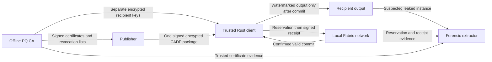
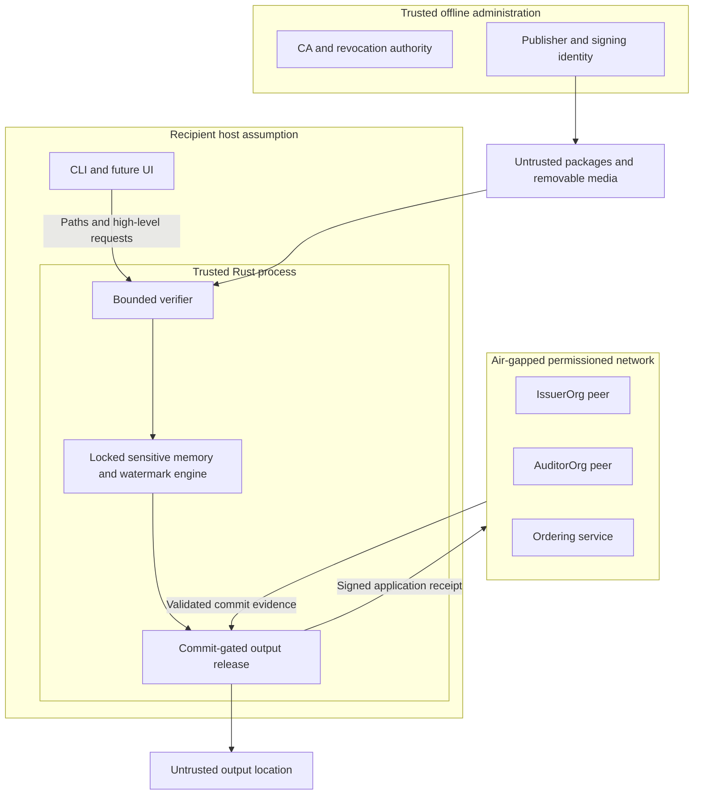

# Architecture

Status: PLANNED design baseline, Phase 0. Only documentation/scaffold is implemented.
The requirements remain in [PROJECT_SPEC.md](PROJECT_SPEC.md).

## Components and data flow



Publisher reads an existing source document and encrypts its content once. The
recipient-side prohibition on new unwatermarked files does not forbid the
publisher's pre-existing input; publisher tooling must not create extra plaintext
copies or temporary files. Recipient entries wrap the same CEK independently.

Rust owns the future PQ wrappers, package verifier, secret buffers, state machine,
in-process watermarking and release operation. Python can orchestrate CA and
forensic workflows; production private-key handling should stay inside Rust where
practical. Go chaincode will validate application signatures through liboqs;
the deployment mechanism is an explicit Phase 6 gate. No GUI or JS crypto in Phase 0.

## Trust boundaries



The UI, paths, package bytes, PDF contents and network responses are untrusted.
The core, its dependencies, OS and enrolled CA/publisher authorities must behave
as assumed. A local air-gapped LAN is allowed; public internet is not required.
Ledger metadata is visible to network administrators; private document bytes and
keys never enter the ledger. See [SECURITY_ASSUMPTIONS.md](SECURITY_ASSUMPTIONS.md).

## Trusted client state machine

```text
PACKAGE_LOADED -> PACKAGE_VALIDATED -> RECIPIENT_VALIDATED
-> RESERVATION_COMMITTED -> KEYS_UNLOCKED -> CEK_RECOVERED
-> CONTENT_DECRYPTED_IN_MEMORY -> WATERMARK_APPLIED
-> WATERMARK_SELF_VERIFIED -> RECEIPT_SIGNED -> RECEIPT_COMMITTED
-> OUTPUT_RELEASED -> CLEANUP_COMPLETE
```

Only listed forward transitions are legal. Every failure/cancellation enters a
terminal abort with cleanup; unknown commit state is not success. No output file
is opened before a valid matching receipt commit is confirmed. Freeze the final
watermarked byte buffer before hashing/signing, then write those exact bytes.
A crash after commit can leave a receipt without output; the converse is forbidden.
After commit, an interrupted write can leave a partial watermarked file: clean it
up where possible and never label it a complete output. Exact atomic filesystem
publication and symlink defenses must be tested in Phase 8.

Phase 5 mocks are test-only, cannot authorize production release, and must not
be confused with the Phase 8 real-ledger invariant. Public operations are only
`inspect_package`, `verify_package`, and `decrypt_and_attribute` (future APIs).
No raw-plaintext or key-export API is permitted.

## Secret lifetimes and resource ownership

Private keys are unlocked only after reservation commit; passwords, private keys,
shared secret, KEK, CEK and plaintext live in owned sensitive buffers with scoped
cleanup. Shared secrets/KEKs are discarded immediately after wrapping/recovery;
CEK after authenticated decryption; unwatermarked buffers after embedding.
Watermark parsers may copy data: audit their allocation/zeroization and scratch-file
behavior before use. No subprocess receives unwatermarked recipient plaintext.
Failures of required memory controls must stop processing before key unlock.
No control is claimed to defeat root or a compromised kernel.

Phase 5 must investigate `mlock` for sensitive allocations versus `mlockall` for the
process, `MADV_DONTDUMP`, `PR_SET_DUMPABLE=0`, and `RLIMIT_CORE=0`. Establish the
required policy before secrets are unlocked; check every return value. Bound the
working set against actual lock limits and account for parser/library copies.
Document which controls are effective on the chosen deployment and test their
failure paths. Avoid pretending that zeroization prevents swapping or that a core
limit alone disables all host crash collection. The current host defaults are
recorded in [ENVIRONMENT.md](ENVIRONMENT.md) and are not approved for real secrets.
