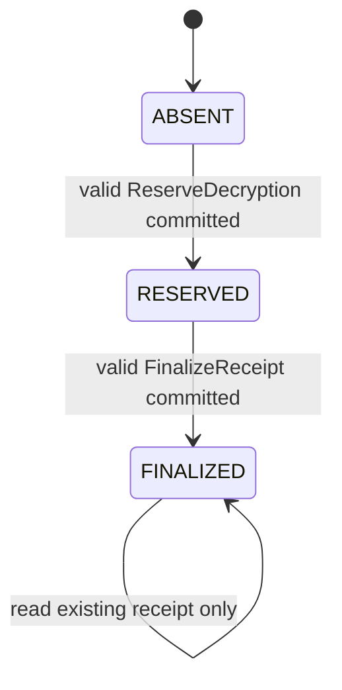

# Ledger Protocol

Status: PLANNED. No chaincode, network or commit verification exists yet.

## Trust, topology and permissions

Two peers: IssuerOrg/IssuerMSP and AuditorOrg/AuditorMSP; one initial orderer;
channel `provenancechannel`. Critical registration, revocation, reservation and
finalization writes require `AND('IssuerMSP.peer','AuditorMSP.peer')`. Endorsement
is necessary but does not replace chaincode authorization or commit validation.
The single-orderer prototype sacrifices availability; administrator collusion and
rollback remain limitations. Native Fabric credentials are infrastructure identities.

`RegisterRecipient`, `RevokeRecipientKey`, `RegisterDocument` are authorized
administrative operations. RegisterRecipient verifies the CA certificate and binds
both PQ keys and IDs; revocation covers either key. Registration also binds the
recipient_id to an authorized Fabric submitter identity. Reserve/Finalize require
that exact mapping, never a caller-supplied identity string alone. Provisioning this
mapping is a Phase 6 deployment gate. Publisher document registration requires its
approved role. Read operations use channel ACLs; metadata is not public internet data.

## State and records

The final self-loop is read-only. A second finalization attempt is rejected.
Aborted workflows may leave unused reservations; no receipt/output is implied.
No reservation reuse or expiry-based resurrection. A new attempt creates a new
nonce and reservation ID.

| Key | Immutable binding / update policy |
|---|---|
| IDENTITY::recipient_id::signature_key_id | Certificate bytes/hash, both key IDs/public keys, enrollment mapping; preserve history; monotonic revoked status |
| DOCUMENT::document_id | Publisher identity/key, manifest_sha256, encrypted_content_sha256, allowed recipient/key/certificate tuples; immutable |
| RESERVATION::reservation_txid | Document/hash/recipient/key/certificate tuple, reservation nonce, channel, submitter, revocation epoch; immutable |
| RECEIPT::reservation_txid | Canonical receipt bytes, signature, finalization transaction reference; create once |
| NONCE::recipient_id::nonce | Uniqueness index; prevents replay through a fresh Fabric transaction ID |

IDs are rendered as lowercase hex for state keys; no arbitrary delimiter-containing
strings. Duplicate identity/document registration rejects; rotation creates a new
key record and preserves historical verification evidence. Key status changes are
monotonic. Signed CRL imports must not reduce the accepted epoch.

## ReserveDecryption

Inputs: document_id, recipient_id, signature_key_id, kem_key_id,
manifest_sha256, nonce:B[32]. Validate bounded input, channel caller mapping,
registered publisher/document, authorization tuple, current certificate validity,
active keys, accepted revocation state and unused nonce. Record the proposal's
Fabric transaction ID as reservation_txid only when that transaction commits valid.
Client must verify the returned committed record matches its verified package.
Fabric reservation IDs are version-1 64-character lowercase hex text (32-byte value);
the watermark stores their decoded 32 bytes. Confirm this contract in Phase 6.

## Receipt schema

Canonical receipt is S("CADP-RECEIPT-v1", body). All fields required except the
explicit optional claimed timestamp. No unknown fields; exact CBOR profile applies.

| Field | Type / constraint |
|---|---|
| schema_version, event_type | 1, `DECRYPTION_ATTRIBUTION` |
| reservation_txid | ASCII lowercase hex, exactly 64 bytes |
| document_id, encrypted_content_sha256, manifest_sha256 | B[32] each |
| recipient_id, signature_key_id, kem_key_id | B[32] each |
| watermark_scheme | `CADP-TEXT-v1` or `CADP-PDF-v1` |
| watermark_payload_sha256 | B[32], H(frame before ECC/carrier mapping) |
| final_output_sha256 | B[32], H(exact frozen watermarked output bytes) |
| trusted_client_version, trusted_client_build_id | ASCII 1..128 bytes each; claims, not attestation |
| receipt_nonce | fresh OS-random B[32] |
| optional_claimed_timestamp | U64 if present; not authoritative time |
| channel_id | `provenancechannel` (bind cross-channel replay context) |

Maximum signed receipt envelope 16 KiB; certificate 16 KiB; nesting <= 8.
No document plaintext, passwords, private keys, CEK, KEK or shared secrets on ledger.

## FinalizeReceipt and concurrency

Validate strict decoding, expected schema and channel; reservation exists and is
unfinalized; all identity, document, key and hash fields match reserved/registered
state; both keys and certificate remain acceptable at finalization. Verify ML-DSA-65
with the stored certified signing key, never a public key submitted in the request.
Read the reservation, identity revocation version and document state into the
transaction read set; create receipt and finalized marker atomically. Concurrent
finalizations/revocations must cause appropriate MVCC conflicts, never two successful
finalizations. Revocation that commits first invalidates stale finalization state.
Historical receipts remain evidence; later compromise/revocation must be disclosed
without silently reclassifying them as current credentials.

Pure deterministic signature verification must occur within the endorsed chaincode
execution boundary. Go/liboqs or external-chaincode packaging remains Q-04. A client
claim that verification succeeded is unacceptable. Chaincode must not use local
wall clocks or randomness for consensus decisions. A deterministic, administered
validity-time policy remains Q-03/Q-04; client timestamps are not trusted time.

## Commit confirmation and release

Proposal endorsement, successful submission, orderer acknowledgement and mere
transaction inclusion do not equal a valid committed transaction. Confirm transaction
validation status VALID on both required organizations, and retrieve matching
reservation/receipt state over authenticated channels. Bind channel, transaction ID,
receipt bytes/signature and output hash. Persist only public transaction references
for recovery. Timeout, inconsistent peers, unknown state or invalid status means
no output. Query the existing transaction/receipt after ambiguity; do not blindly
submit a new finalization or assume a duplicate error is proof of success.

Crash after commit but before release may leave a receipt with no output. It does
not violate `OUTPUT_RELEASED implies RECEIPT_COMMITTED`. Recovery must reconstruct
and verify exact matching bytes or begin a new reservation; never reuse a committed
receipt for different bytes. Restart cannot restore plaintext from disk.

These commit requirements reflect Fabric's validation stage described in the
[official transaction flow](https://hyperledger-fabric.readthedocs.io/en/latest/txflow.html).
The precise authenticated evidence API and offline checkpoint policy must be tested
in Phase 6/8; they are not implemented guarantees.
